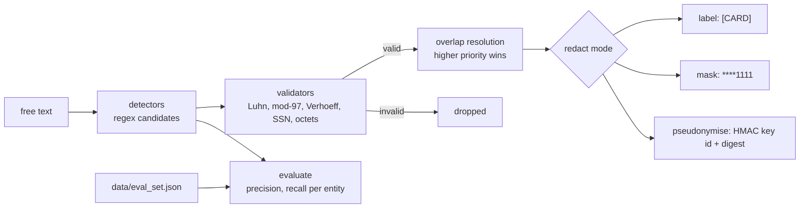

# Jagadish-pii-guard

[](https://github.com/jagadishmazure-jpg/Jagadish-pii-guard/actions/workflows/ci.yml)
[](https://github.com/jagadishmazure-jpg/Jagadish-pii-guard/actions/workflows/codeql.yml)


**Find and redact personal data in free text before it reaches a model or a log: regex candidates confirmed by checksum validators, three redaction modes, keyed pseudonyms, and a measured eval with its known gaps.**

> Personal learning and portfolio project. Everything runs offline on synthetic,
> fictional data with no API keys. Nothing is deployed. Numbers in this README
> come from real runs and are re-checked by CI (`scripts/render_docs.py --check`).

## Recruiter summary

- Detects 8 entity types (email, card, IBAN, Aadhaar, SSN, Indian PAN, phone, IPv4); each regex hit must pass a validator (Luhn, mod-97, Verhoeff, SSA rules, octet range) where one exists.
- Real run on a 24-sentence labelled set (16 PII values): precision and recall 1.000 with validators; regex only drops to precision 0.652 with 8 false positives. The set is mine, so I treat this as a regression check.
- Tokenization layer for stored data: keyed format-preserving tokens (card, SSN, phone) and a token vault (email). In a real run, a thief holding the encrypted store **and** its key recovered 0 of 12 sensitive values (12 of 12 without tokenization); joins on tokens matched joins on raw values; detokenization is role-gated and audited. See [docs/tokenization.md](docs/tokenization.md).
- Three known misses are kept as tests on purpose (no-separator phones, obfuscated emails, names), so the limits are visible.

## Purpose

Most agent repos here say "PII is redacted before the model call". This repo
is that step on its own, small enough to read in one sitting and tested
against labelled data. It answers two interview questions directly: how do
you stop a 16-digit order number being treated as a card, and how do you
pseudonymise so the token cannot be reversed by hashing every possible SSN.

## Architecture



## How it works

**Detect** (`piiguard/detectors.py`): each `Detector` has an entity name, a
regex, an optional validator and a priority. All candidates are collected,
invalid ones dropped, and overlapping spans resolved by priority.

**Validate** (`piiguard/validators.py`): Luhn for cards, ISO 13616 mod-97 for
IBAN, Verhoeff plus first-digit rule for Aadhaar, SSA area/group/serial rules
for SSN, 0 to 255 per octet for IPv4.

**Redact** (`piiguard/redact.py`): `label`, `mask` (last 4 kept) or
`pseudonymise` (HMAC-SHA256 with a key from `PIIGUARD_KEY` and a key id in
the token). No key means it refuses, rather than falling back to a plain hash.

**Evaluate** (`piiguard/evaluate.py`): exact-value precision and recall per
entity on `data/eval_set.json`, with validators on and off. Details:
[docs/entities.md](docs/entities.md).

## Real code and output

```python
"""Detect and redact PII three ways, then score the detectors.

All values are synthetic or public test numbers. The pseudonymisation key
below is a demo value; real keys come from PIIGUARD_KEY (e.g. Key Vault).
"""
from piiguard import Redactor, detect
from piiguard.evaluate import report

text = ("Hi, I'm writing about card 4111 1111 1111 1111. Email ann.lee@example.com or call "
        "(555) 014-2398. SSN 123-45-6789. Order 4111 1111 1111 1112 is not a card.")
print("input:   ", text)
print("findings:", [(f.entity, f.start, f.end) for f in detect(text)])
print("label:   ", Redactor("label").redact(text).text)
print("mask:    ", Redactor("mask").redact(text).text)
print("pseudo:  ", Redactor("pseudonymise", key="demo-key-not-a-secret-0001").redact(text).text)
print()
print(report())
```

Output of `python examples/demo.py` (real run, re-checked in CI):

<!-- run: python examples/demo.py -->
```text
input:    Hi, I'm writing about card 4111 1111 1111 1111. Email ann.lee@example.com or call (555) 014-2398. SSN 123-45-6789. Order 4111 1111 1111 1112 is not a card.
findings: [('CARD', 27, 46), ('EMAIL', 54, 73), ('PHONE', 82, 96), ('SSN', 102, 113)]
label:    Hi, I'm writing about card [CARD]. Email [EMAIL] or call [PHONE]. SSN [SSN]. Order 4111 1111 1111 1112 is not a card.
mask:     Hi, I'm writing about card ****1111. Email ****.com or call ****2398. SSN ****6789. Order 4111 1111 1111 1112 is not a card.
pseudo:   Hi, I'm writing about card <CARD:v1:889b78c3>. Email <EMAIL:v1:cc52ec60> or call <PHONE:v1:55704f92>. SSN <SSN:v1:f08d2b77>. Order 4111 1111 1111 1112 is not a card.

24 labelled sentences, 16 PII values

| Entity | TP | FP | FN | precision | recall |
|---|---:|---:|---:|---:|---:|
| AADHAAR | 2 | 0 | 0 | 1.000 | 1.000 |
| CARD | 3 | 0 | 0 | 1.000 | 1.000 |
| EMAIL | 3 | 0 | 0 | 1.000 | 1.000 |
| IBAN | 1 | 0 | 0 | 1.000 | 1.000 |
| IPV4 | 1 | 0 | 0 | 1.000 | 1.000 |
| PAN_IN | 1 | 0 | 0 | 1.000 | 1.000 |
| PHONE | 3 | 0 | 0 | 1.000 | 1.000 |
| SSN | 2 | 0 | 0 | 1.000 | 1.000 |
| ALL | 16 | 0 | 0 | 1.000 | 1.000 |

Regex only (validators off): precision 0.652, recall 0.938, false positives 8 (with validators: 0)

Known gaps (kept as failing cases on purpose): 3 of 3 missed
- phone with no separators is not matched (too easy to confuse with IDs)
- obfuscated emails are not matched
- no name detection: needs an NER model (planned)
```
<!-- /run -->

## Tokenization layer

Redaction handles text on its way out; tokenization handles values you must
keep. Card, SSN and phone numbers become same-format tokens through a keyed
Feistel cipher; emails get random tokens backed by a sealed vault. Tokens are
deterministic, so tables still join. Rows are then stored encrypted, and the
token key is kept apart from the storage key. Real run of
`python examples/tokenization_demo.py` (theft section):

```text
attacker steals encrypted store + its key:
  raw rows (control):  recovered 12/12 sensitive values, 12 PII-shaped spans
  tokenized rows:      recovered 0/12 sensitive values, 5 PII-shaped spans
```

The 5 spans are tokens that look like an SSN or phone number, not real
values. Measured latency (pure Python, 5,000 values): about 20 us median per
vaultless tokenize or detokenize, about 11 us per vault detokenize. Full
write-up, guardrails, limits and adopter guide:
[docs/tokenization.md](docs/tokenization.md).

## How to run

```bash
git clone https://github.com/jagadishmazure-jpg/Jagadish-pii-guard.git
cd Jagadish-pii-guard
python -m pip install pytest      # no runtime dependencies
python -m pytest -q          # offline, no keys
python examples/demo.py
python scripts/render_docs.py --check   # documented output still matches
```

Test suite size (real collection, re-checked in CI):

<!-- run: python scripts/count_tests.py -->
```text
52 tests collected
```
<!-- /run -->

## Guardrails

- A candidate is only reported if its validator passes, which removes look-alike order numbers and placeholder SSNs.
- Pseudonymisation is keyed (HMAC-SHA256) and fails closed without a key of at least 16 bytes.
- The key id is part of every pseudonym, so tokens can be traced to the key that made them after rotation.
- Known gaps are tests, so a silent change in behaviour is caught.

## Limitations

- The eval set is 24 sentences I wrote; 1.000 means it passes its own regression set, not that it is production grade.
- No name, address or free-form ID detection; those need an NER model.
- Phone support is North American format with separators only.
- English-only patterns; no handling of PII split across lines or inside images.

## Built vs planned

| Capability | Status | Where |
|---|---|---|
| 8 detectors with validators and overlap resolution | Built | `piiguard/detectors.py`, `piiguard/validators.py` |
| label, mask and keyed pseudonymise modes | Built | `piiguard/redact.py` |
| Per-entity precision/recall with validators on and off | Built | `piiguard/evaluate.py`, `data/eval_set.json` |
| Known-gap tests | Built | `data/known_gaps.json` |
| Vaultless FPE tokens, token vault, role-gated audited detokenization | Built | `piiguard/tokenization.py` |
| Encrypted store (teaching cipher) and store+key theft test | Built | `piiguard/sealed_store.py`, `tests/test_tokenization.py` |
| Certified FF1 / AES-GCM, key rotation, persistent vault | Planned | docs/tokenization.md |
| NER for names and addresses | Planned | docs/implementation-guide.md |
| Larger, externally sourced eval set | Planned | not started |

## Threat model

| Threat | Mitigation in this repo | Status |
|---|---|---|
| Raw PII sent to a third-party model | Redact before the call; only labels leave | Built |
| Pseudonyms reversed by hashing candidate values | Keyed HMAC, key from env, fail closed | Built |
| Look-alike numbers redacted, breaking the answer | Validators drop invalid candidates | Built |
| Names and addresses leak | Needs NER; listed as a known gap | Planned |
| Database and its encryption key both stolen | Fields tokenized with a separate token key; 0/12 values recovered in test | Built |
| Insider detokenizes without need | Role policy, deny by default, audit log with fingerprints only | Built |
| Token key stolen | Separate key service; rotation | Planned |
| Key leaked from config | Key Vault and managed identity | Planned |

## Interview points

- Validators, not bigger regexes, are what cut false positives: precision 0.652 to 1.000 on the same set.
- An unkeyed hash of an SSN is reversible by brute force over about a billion values; a keyed HMAC is not without the key.
- Overlap resolution matters: a card number contains a phone-shaped substring.

More, with likely follow-up questions: [docs/interview-points.md](docs/interview-points.md).

## Implementation guide

The step-by-step path from this offline build to an Azure deployment is in
[docs/implementation-guide.md](docs/implementation-guide.md). None of it has been
run; it is a plan.

## Related repositories

| Repo | How it relates |
|---|---|
| [Jagadish-bank-support-agents](https://github.com/jagadishmazure-jpg/Jagadish-bank-support-agents) | Uses the same redact-before-model idea in a support agent |
| [Jagadish-data-governance](https://github.com/jagadishmazure-jpg/Jagadish-data-governance) | Column masking and keyed pseudonyms on tables |
| [Jagadish-agent-security-redteam](https://github.com/jagadishmazure-jpg/Jagadish-agent-security-redteam) | Attacks that try to extract PII from agents |
| [Jagadish-llm-evals-observability](https://github.com/jagadishmazure-jpg/Jagadish-llm-evals-observability) | Where PII leakage would be tracked as a metric |

## Documentation

- [Entities, validators and modes](docs/entities.md)
- [Tokenization layer](docs/tokenization.md) and [ADR 0001](docs/adr/0001-tokenization.md)
- [Implementation guide (Azure)](docs/implementation-guide.md)
- [Interview points](docs/interview-points.md)
- [Security policy](SECURITY.md)

## Project layout

```
piiguard/
  validators.py  Luhn, mod-97, Verhoeff, SSN, IPv4
  detectors.py   regex + validator + priority, overlap resolution
  redact.py      label, mask, keyed pseudonymise
  evaluate.py    precision/recall on the labelled set
  tokenization.py vaultless FPE, token vault, role-gated detokenizer
  sealed_store.py encrypt-then-MAC record store (teaching cipher)
data/            eval_set.json, known_gaps.json
examples/demo.py the run shown above
examples/tokenization_demo.py  joins, theft test, RBAC
scripts/bench_tokenization.py  latency
tests/           offline pytest suite
```

## License

MIT, see [LICENSE](LICENSE). All data is synthetic; every organisation and person is fictional.
