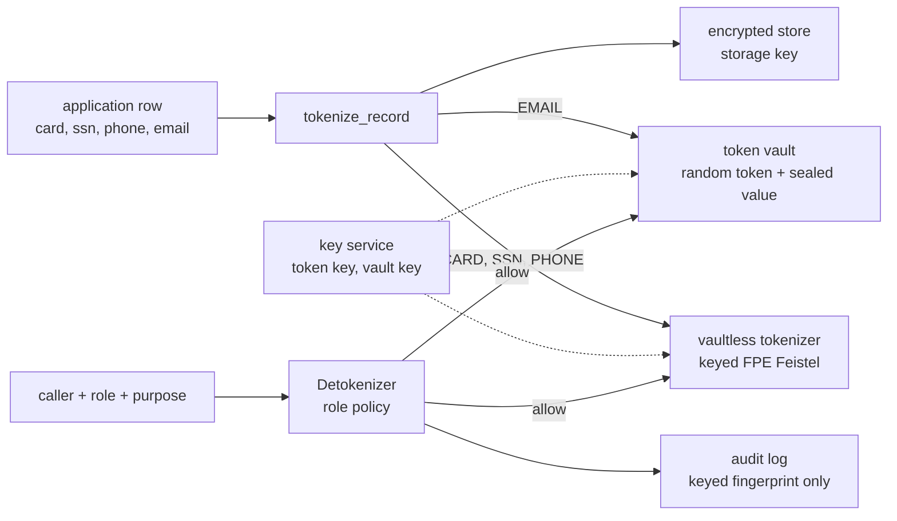

# Tokenization layer

## Purpose

Redaction (the rest of this repo) removes personal data from text that is
about to leave. Tokenization solves a different problem: data you must keep,
such as card numbers and SSNs in a customer table. Encrypting that table is
necessary but not enough, because encryption only protects you while the key
stays secret. A thief who gets the database and the key that sits next to it
(a leaked config, a compromised service account, or a future break of today's
ciphers) reads everything. Tokenization swaps each sensitive value for a
stand-in before it is stored, so a stolen copy holds stand-ins only. Analytics
still work because the same value always maps to the same token, so tables
can be joined on tokens. Only a small set of roles can turn a token back into
the real value, and every attempt is logged.

Who it is for: engineers designing data platforms or agent back ends that
hold payment, health or identity data, and interviewers asking "what happens
when the key leaks?".

## Architecture



Three separate secrets: the storage key (with the database), the token key
and the vault key (in a key service the database cannot reach). Stealing the
first gives tokens, not values.

## How it works

1. **Vaultless, format-preserving** (`VaultlessTokenizer`). Digits are split
   into two halves and mixed for 10 rounds; each round adds an HMAC-SHA256 of
   the other half (keyed with the token key, tweaked by field type) modulo a
   power of ten. Output has the same number of digits, and separators are put
   back, so a card token still fits a 16-digit column. Cards keep the last
   four digits in the clear (the usual support-call compromise). The process
   is reversible only with the token key and is deterministic, so equal
   inputs give equal tokens.
2. **Vaulted** (`TokenVault`). For free-form values like email addresses, a
   random `tok_email_<hex>` is issued and the real value is sealed in a
   separate vault store. A keyed HMAC index returns the existing token for a
   repeat value, so vaulted tokens are joinable too.
3. **Encrypted store** (`SealedStore`). Rows are sealed with encrypt-then-MAC.
   Wrong key or a flipped bit raises `StoreError`. This is a standard-library
   stand-in for AES-GCM so the tests can hand the attacker the key.
4. **Detokenization** (`Detokenizer.reveal`). Role and field type are checked
   against a policy. Every call, allowed or denied, appends an audit event
   with role, type, purpose and a 10-hex keyed fingerprint of the token.
   Denials raise `AccessDenied` whose message contains only the fingerprint.

## Real code and output

Output of `python examples/tokenization_demo.py` (real run, re-checked in CI):

<!-- run: python examples/tokenization_demo.py -->
```text
customer: {'id': 1, 'card': '7714 8658 2875 1111', 'ssn': '961-83-6080', 'phone': '(214) 422-3306'} email: tok_email...
customer: {'id': 2, 'card': '2297 7189 4508 0004', 'ssn': '053-71-9968', 'phone': '(256) 747-9727'} email: tok_email...
customer: {'id': 3, 'card': '9259 907344 20005', 'ssn': '819-72-7473', 'phone': '(863) 540-5775'} email: tok_email...

join on raw cards: [(1, 5.0), (1, 42.1), (3, 9.99)]
join on tokens:    [(1, 5.0), (1, 42.1), (3, 9.99)]  identical=True

attacker steals encrypted store + its key:
  raw rows (control):  recovered 12/12 sensitive values, 12 PII-shaped spans
  tokenized rows:      recovered 0/12 sensitive values, 5 PII-shaped spans

fraud_analyst reveals card: 4111 1111 1111 1111
denied: role 'support_agent' may not detokenize SSN (token 22c818f20d)
denied: role 'marketing' may not detokenize PHONE (token e8c1270ee1)
audit log:
  role=fraud_analyst  kind=CARD  token_fp=b44fae8e05 decision=allow purpose=case-1
  role=support_agent  kind=SSN   token_fp=22c818f20d decision=deny purpose=case-2
  role=marketing      kind=PHONE token_fp=e8c1270ee1 decision=deny purpose=case-2
```
<!-- /run -->

"PII-shaped spans" are format-preserving tokens that look like an SSN or a
phone number to the detector. They are not the real values (0 of 12 were
recovered), but it does mean downstream redaction should know which columns
are already tokens.

### Latency

From `python scripts/bench_tokenization.py` on the build box (5,000 values per
operation, pure Python, one core). Timing varies by machine, so it is not part
of the CI doc check:

| operation | median us | p95 us |
|---|---:|---:|
| vaultless CARD tokenize | 19.7 | 26.1 |
| vaultless CARD detokenize | 22.5 | 26.6 |
| vaultless SSN tokenize | 20.5 | 26.0 |
| vaultless SSN detokenize | 19.9 | 26.2 |
| vaulted EMAIL tokenize (new) | 13.9 | 19.5 |
| vaulted EMAIL tokenize (repeat) | 1.9 | 2.1 |
| vaulted EMAIL detokenize (5000-row vault) | 11.2 | 13.4 |

(python 3.13.5, 5000 values per op, roundtrip ok=True; measured 2026-10-23.)

## How to run

```bash
python -m pytest -q tests/test_tokenization.py
python examples/tokenization_demo.py
python scripts/bench_tokenization.py
```

No keys, network or cloud needed. The keys in the demo are labelled constants.

## Guardrails

- Keys under 16 bytes are refused for the token, vault and storage keys.
- Token key and storage key are separate objects; nothing in the store module can reach the token key.
- Type tweak: the same digits tokenized as PHONE and as SSN give different tokens.
- Detokenization is deny-by-default; an unknown role gets nothing.
- Errors and audit events carry a keyed fingerprint, never the value or the token; a test pushes every error and log line through the detector and string-matches all raw values.
- `tokenize_record` re-raises with the column name only, dropping the original message.

## Limitations

- The Feistel cipher is FF1-shaped but not a certified FF1 implementation, and the sealed store is not AES-GCM. Both are for teaching; use vetted libraries.
- Deterministic tokens leak equality and frequency (the most common token is probably the most common value). That is the price of joins.
- Keeping the last four card digits discloses them by design.
- Small domains are weak: a 9-digit SSN has about a billion values, so a thief who also steals the token key can enumerate. Protecting the token key is the whole game.
- Format-preserving tokens are not Luhn-checked to be invalid, so a token can pass as a real-looking card number.
- The vault and audit log are in memory; no persistence, rotation or rate limiting of detokenization yet.
- Names and free text are not tokenized here; use the redaction modes for those.

## Built vs planned

| Capability | Status | Where |
|---|---|---|
| Vaultless format-preserving tokens for CARD, SSN, PHONE | Built | `piiguard/tokenization.py` |
| Vaulted tokens for EMAIL with deterministic index | Built | `piiguard/tokenization.py` |
| Encrypted store with integrity check | Built (teaching cipher) | `piiguard/sealed_store.py` |
| Role-gated detokenization with audit | Built | `Detokenizer` |
| Theft test: store + storage key gives 0 values | Built | `tests/test_tokenization.py` |
| Join on tokens equals join on raw values | Built | tests and demo |
| Latency benchmark | Built (local run) | `scripts/bench_tokenization.py` |
| Certified FF1 / AES-GCM via a vetted library | Planned | ADR 0001 |
| Key rotation with re-tokenization | Planned | implementation guide |
| Persistent vault, detokenization rate limits, alerting on deny bursts | Planned | not started |

## Implementation guide (adopters)

1. Classify columns: which must be reversible (card for chargebacks), which only need joins (could use one-way HMAC instead), which can be dropped.
2. Put the token key in a key management service the data platform cannot read; the tokenizer runs as a small service with its own identity.
3. Tokenize at ingestion, before data lands in the warehouse, so raw values never reach the encrypted store.
4. Keep the storage encryption too. Tokenization is a second layer, not a replacement.
5. Write the role policy as code, review it like code, and alert on denials.
6. Plan rotation: new key id, re-tokenize in batches, keep the old key for detokenize-only until the backfill finishes.
7. Prove it with the theft test in CI: dump the store with its key and assert no raw value appears.

Background reading: the idea of tokenizing on top of encryption follows an
industry white paper on tokenization beyond encryption (paraphrased, not
quoted). Design choices are recorded in
[adr/0001-tokenization.md](adr/0001-tokenization.md).
